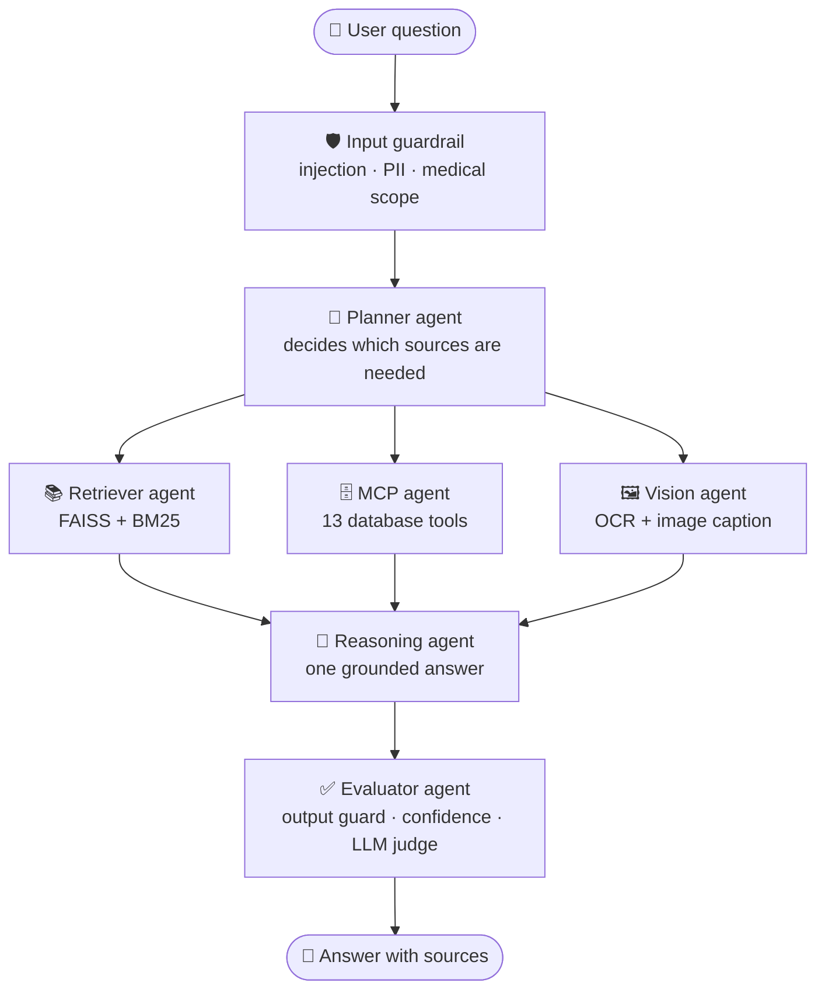

<div align="center">

# 🏥 MediAssist AI

### An agentic AI copilot for hospital staff

Ask about hospital processes, patient records and uploaded reports, and get one grounded answer with its sources.

<p>
  
  
  
  
  
  
  
</p>

<p>
  <a href="#-features">Features</a> •
  <a href="#-screenshots">Screenshots</a> •
  <a href="#-how-it-works">How it works</a> •
  <a href="#-getting-started">Getting started</a> •
  <a href="#-database-tools">Tools</a> •
  <a href="#-deployment">Deployment</a>
</p>

</div>

> [!NOTE]
> All patient data in this project is **synthetic (fake)**, generated by `db/seed_db.py`. No real patient records are used.

---

## ✨ Features

| | Feature | What it does |
|---|---|---|
| 📄 | **Document Q&A (RAG)** | Answers from hospital SOPs and policies, with the source file and page. Upload your own PDF, DOCX or TXT. |
| 🗄️ | **Patient database via MCP** | 13 read-only tools: patient history, labs, billing, doctors and hospital-wide statistics. |
| 🖼️ | **Medical image reading** | OCR and a vision model read prescriptions and lab reports, then extract medicines, diagnoses and dates. |
| 🛡️ | **Guardrails** | Blocks prompt injection and database-changing requests, masks phone, email and Aadhaar numbers, and refuses non-medical questions. |
| 📊 | **Built-in evaluation** | Every answer gets a confidence score and an LLM-as-a-Judge check, shown on an evaluation dashboard. |
| 🔐 | **Login** | Sign-up and log-in with bcrypt-hashed passwords. |

---

## 📸 Screenshots

<div align="center">

**Login**


<br><br>

**Chat and uploads**


<br><br>

**Hospital knowledge base**


</div>

---

## 🧠 How it works



The agents are connected with **LangGraph**. The database is reachable only through the **MCP server**, which uses read-only connections, parameterised queries and a 10-second timeout.

---

## 🧰 Tech stack

| Layer | Technology |
|---|---|
| Frontend | Streamlit |
| Backend | FastAPI |
| Agents | LangGraph, LangChain |
| LLM | Groq (`openai/gpt-oss-120b`) |
| Embeddings | Hugging Face `all-MiniLM-L6-v2` |
| Search | FAISS (meaning) + BM25 (keywords) |
| Database | PostgreSQL on Neon, accessed through MCP |
| Image reading | EasyOCR + BLIP |
| Evaluation | LLM-as-a-Judge |
| Packaging and hosting | Docker, Azure Container Apps |

---

## 🗄️ Database tools

<details>
<summary><b>Click to see all 13 MCP tools</b></summary>

<br>

| Tool | Purpose |
|---|---|
| `search_patients` | Find patients by name, city or ID |
| `get_patient_history` | Profile with recent admissions and prescriptions |
| `get_patient_summary` | One-page overview of a patient |
| `get_admissions` | Admissions with department, doctor and branch |
| `get_prescriptions` | Medicines prescribed to a patient |
| `get_appointments` | Appointments of a patient |
| `get_lab_results` | Lab results of a patient |
| `get_billing_summary` | Bills, totals and payments |
| `get_insurance_details` | A patient's policy, or billing totals per insurer |
| `get_doctor_schedule` | A doctor's appointments on a date |
| `search_doctors` | Find doctors by name, specialty, department or city |
| `search_lab_tests` | Lab results across all patients, with counts per status |
| `get_department_statistics` | Admissions by department, appointment trends, top diagnoses, billing by department |

</details>

---

## 💡 Try these questions

| Type | Example |
|---|---|
| 📄 Documents | `What is the admission process?` |
| 👤 One patient | `Show patient history for P00001` |
| 💊 Prescriptions | `Show prescriptions for P00001` |
| 🏥 Statistics | `Which department had the most admissions in 2025?` |
| 🩺 Doctors | `Find cardiologists in Pune` |
| 💰 Billing | `Analyze billing by insurance provider` |
| 🖼️ Image | Upload a prescription, select it in the chat, then ask `Extract the medicines from this prescription.` |

---

## 📁 Project structure

```
MediAssist_AI/
├── app/
│   ├── agents/        planner, retriever, MCP, vision, reasoning, evaluator
│   ├── guardrails/    input, output, PII and file checks
│   ├── mcp/           MCP server, client and database tools
│   ├── multimodal/    OCR, image processing, report analysis
│   ├── rag/           loading, chunking, embedding, vector store, retrieval
│   ├── config.py      settings read from .env
│   ├── llm.py         LLM setup
│   └── prompts.py     all prompts
├── backend/           FastAPI app and login routes
├── frontend/          Streamlit app
├── db/                schema.sql and seed_db.py (fake data)
├── data/raw/          hospital documents used by the search
├── photos/            screenshots used in this README
├── tests/             automated tests
├── Dockerfile
├── docker-compose.yml
└── start.sh           starts FastAPI (8000) and Streamlit (7860)
```

---

## 🚀 Getting started

### 1. Get the code

```bash
git clone https://github.com/atharvwagh23/MediAssist_AI.git
cd MediAssist_AI
```

### 2. Create a free PostgreSQL database

Use any hosted PostgreSQL, for example [Neon](https://neon.com). Turn **connection pooling off**, then note the host, database, user and password.

### 3. Create your `.env` file

Copy `_.env_example` to `.env` and fill in:

| Setting | Value |
|---|---|
| `LLM_PROVIDER` | `groq` |
| `GROQ_API_KEY` | Your key from [console.groq.com](https://console.groq.com) |
| `JUDGE_MODEL` | `openai/gpt-oss-120b` |
| `DB_HOST` `DB_PORT` `DB_NAME` `DB_USER` `DB_PASSWORD` | From your database (`DB_PORT` is `5432`) |
| `DB_SSLMODE` | `require` |
| `AUTH_SECRET` | Any long random text (40+ characters) |
| `LANGSMITH_TRACING` | `false` (LangSmith is optional) |

> [!WARNING]
> Never commit `.env`. It is already listed in `.gitignore`.

### 4. Fill the database with fake data

```bash
pip install psycopg2-binary python-dotenv
python db/seed_db.py
```

This creates 11 tables and about 25,000 rows (2,000 patients). Use `--patients 5000` for more.

> [!CAUTION]
> `seed_db.py` drops and recreates the tables. Never point it at a database that holds data you want to keep.

### 5. Run with Docker

```bash
docker compose up --build
```

The first build takes about 20 to 30 minutes because it downloads PyTorch and the OCR, vision and embedding models. Later builds are fast. Then open **http://localhost:7860**, sign up, and start asking.

<details>
<summary><b>Run without Docker (optional)</b></summary>

<br>

Python 3.12 is required.

```bash
uv sync
python -m app.rag.ingest
uvicorn backend.main:app --port 8000
streamlit run frontend/app.py
```

Run the last two commands in separate terminals, and set `BACKEND_URL=http://localhost:8000` in `.env`.

</details>

---

## 🧪 Tests

Run from the project root. The MCP test needs the seeded database.

```bash
python -m tests.test_agents
python -m tests.test_guardrails
python -m tests.test_mcp
```

---

## ☁️ Deployment

The app runs on **Azure Container Apps** as a single container.

1. Create a resource group and an Azure Container Registry.
2. Build and push the image:
   ```bash
   docker build --platform linux/amd64 -t <registry>.azurecr.io/mediassist:v1 .
   az acr login -n <registry>
   docker push <registry>.azurecr.io/mediassist:v1
   ```
3. Create a Container App from that image: target port `7860`, external ingress, 2 CPU and 4 Gi memory.
4. Add the `.env` settings as environment variables, and put passwords and keys in secrets.
5. Set minimum replicas to `0` so it sleeps when idle, or `1` to keep it always on.

---

## ⚠️ Known limitations

- **Accounts and uploads are temporary.** Users, images and extraction results live inside the container and are lost on restart or redeploy.
- **Slow first request.** When scaled to zero, the first visit takes 30 to 90 seconds while the models load.
- **Answers are not streamed.** The full reply is generated first, then displayed.
- **Learning project, not a medical device.** It explains what the records say and does not give medical advice.

---

<div align="center">

Built by **Atharv** · [@atharvwagh23](https://github.com/atharvwagh23)

If you find this project useful, consider giving it a ⭐

</div>
